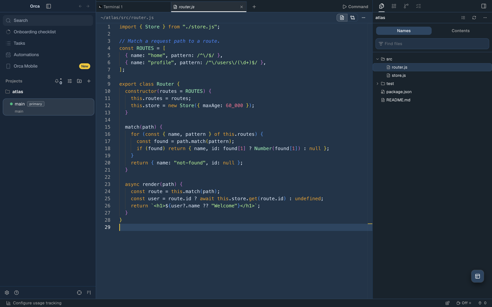

# Cobalt2 for Orca

[Cobalt2](https://github.com/wesbos/cobalt2-vscode) by Wes Bos for [Orca](https://github.com/stablyai/orca):
a deep blue app theme with Cobalt2's syntax colors and a matching terminal palette.

## Install

1. In Orca, open **Settings → Plugins**.
2. Choose **Add plugin → From a Git URL…** and enter
   `https://github.com/dawidwetzler/orca-cobalt2-theme.git`.
3. In **Settings → Appearance**, pick **Cobalt2** as the dark theme, and pick **Cobalt2** as the
   terminal theme.

## Colors

| | Color |
| --- | --- |
| Keywords | orange `#ff9d00` |
| Strings | green `#a5ff90` |
| Numbers and constants | pink `#ff628c` |
| Comments | blue `#0088ff`, italic |
| Types and classes | mint `#80ffbb` |
| Attributes, object keys and headings | yellow `#ffc600` |
| `this` and `self` | purple `#fb94ff`, italic |
| Tags | cyan `#9effff` |
| Text and punctuation | `#e1efff` |

Orca's editor separates fewer kinds of tokens than VS Code for some languages. In those, words that
Cobalt2 colors differently in VS Code, such as `const` and `function`, share the keyword color.

## Attribution

An unofficial Orca port of [Cobalt2](https://github.com/wesbos/cobalt2-vscode) by Wes Bos and
Roberto Achar. Its license notice is included in [LICENSE](LICENSE).
